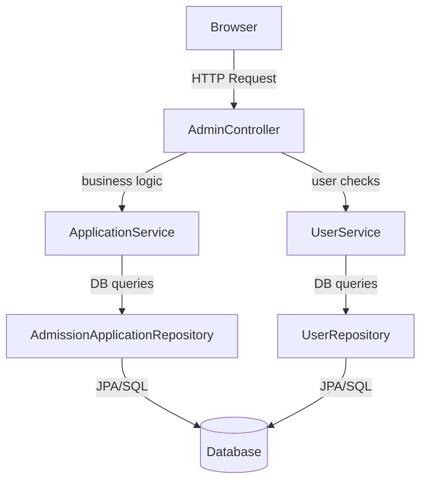

# AdminController → Service → Repository Flow

## Architecture Overview



---

## 1. `GET /admin/dashboard` — Dashboard with Pagination

### Controller
```java
@GetMapping("/dashboard")
public String dashboard(@RequestParam(value = "page", defaultValue = "0") int page,
                        @RequestParam(value = "size", defaultValue = "5") int size,
                        Model model) {
    if (page < 0) page = 0;
    if (size <= 0) size = 5;
    Page<AdmissionApplication> applicationPage = applicationService.getApplicationsPaged(page, size);

    model.addAttribute("totalCount",    applicationService.countTotal());
    model.addAttribute("pendingCount",  applicationService.countPending());
    model.addAttribute("approvedCount", applicationService.countApproved());
    model.addAttribute("rejectedCount", applicationService.countRejected());
    model.addAttribute("applicationPage",     applicationPage);
    model.addAttribute("recentApplications",  applicationPage.getContent());
    model.addAttribute("currentPage",    page);
    model.addAttribute("totalPages",     applicationPage.getTotalPages());
    model.addAttribute("totalItems",     applicationPage.getTotalElements());
    return "admin/dashboard";
}
```
**What it does:** Validates page/size, fetches a paginated result, and loads four count stats into the model.

### Service
| Controller call | Service method |
|---|---|
| `getApplicationsPaged(page, size)` | Creates a `PageRequest` and calls repo |
| `countTotal()` | Calls `applicationRepository.count()` |
| `countPending()` | Calls `countByStatus(PENDING)` |
| `countApproved()` | Calls `countByStatus(APPROVED)` |
| `countRejected()` | Calls `countByStatus(REJECTED)` |

```java
public Page<AdmissionApplication> getApplicationsPaged(int page, int size) {
    Pageable pageable = PageRequest.of(page, size);
    return applicationRepository.findAllByOrderByAppliedDateDesc(pageable);
}
public long countPending()  { return applicationRepository.countByStatus(ApplicationStatus.PENDING); }
// same pattern for countApproved / countRejected
```

### Repository
```java
Page<AdmissionApplication> findAllByOrderByAppliedDateDesc(Pageable pageable);
long countByStatus(ApplicationStatus status);
```
Spring Data JPA auto-generates the SQL from the method name. `count()` is inherited from `JpaRepository`.

---

## 2. `GET /admin/applications` — List Applications by Status Filter

### Controller
```java
@GetMapping("/applications")
public String listApplications(@RequestParam(value = "status", required = false, defaultValue = "ALL") String status, Model model) {
    List<AdmissionApplication> applications;
    if ("PENDING".equalsIgnoreCase(status))         applications = applicationService.getApplicationsByStatus(ApplicationStatus.PENDING);
    else if ("APPROVED".equalsIgnoreCase(status))   applications = applicationService.getApplicationsByStatus(ApplicationStatus.APPROVED);
    else if ("REJECTED".equalsIgnoreCase(status))   applications = applicationService.getApplicationsByStatus(ApplicationStatus.REJECTED);
    else                                            applications = applicationService.getAllApplications();
    model.addAttribute("applications", applications);
    model.addAttribute("currentStatus", status);
    return "admin/applications";
}
```
**What it does:** Reads a `?status=` query param and filters accordingly.

### Service
```java
public List<AdmissionApplication> getApplicationsByStatus(ApplicationStatus status) {
    return applicationRepository.findByStatus(status);
}
public List<AdmissionApplication> getAllApplications() {
    return applicationRepository.findAllByOrderByAppliedDateDesc();
}
```

### Repository
```java
List<AdmissionApplication> findByStatus(ApplicationStatus status);
List<AdmissionApplication> findAllByOrderByAppliedDateDesc();
```
Both are Spring Data derived queries — no SQL needed.

---

## 3. `GET /admin/applications/{id}` — View Single Application

### Controller
```java
@GetMapping("/applications/{id}")
public String viewApplication(@PathVariable Long id, Model model) {
    AdmissionApplication app = applicationService.findById(id)
            .orElseThrow(() -> new IllegalArgumentException("Invalid application ID: " + id));

    model.addAttribute("admissionApp", app);
    model.addAttribute("application", app);
    // Pre-fills forms with current values (or defaults)
    String initialClass   = app.getAssignedClass()   != null ? app.getAssignedClass()   : app.getAppliedClass();
    String initialSection = app.getAssignedSection() != null ? app.getAssignedSection() : "AUTO";
    String initialRemarks = app.getRemarks()         != null ? app.getRemarks()         : "";
    model.addAttribute("approvalDto",  new ApprovalDto(initialClass, initialSection, initialRemarks));
    model.addAttribute("rejectionDto", new RejectionDto(""));
    return "admin/application-detail";
}
```
**What it does:** Fetches by ID, throws 400 if not found, pre-fills both the ApprovalDto and RejectionDto forms so the admin can act immediately.

### Service
```java
public Optional<AdmissionApplication> findById(Long id) {
    return applicationRepository.findById(id);
}
```

### Repository
```java
// Inherited from JpaRepository<AdmissionApplication, Long>
Optional<AdmissionApplication> findById(Long id);
```

---

## 4. `POST /admin/applications/{id}/approve` — Approve an Application

### Controller
```java
@PostMapping("/applications/{id}/approve")
public String approveApplication(@PathVariable Long id,
                                 @ModelAttribute("approvalDto") ApprovalDto approvalDto,
                                 RedirectAttributes redirectAttributes) {
    try {
        AdmissionApplication app = applicationService.approveApplication(id, approvalDto);
        redirectAttributes.addFlashAttribute("successMessage",
                "Application " + app.getApplicationNumber() + " approved! Roll: " + app.getPermanentRollNumber());
    } catch (Exception ex) {
        redirectAttributes.addFlashAttribute("errorMessage", ex.getMessage());
    }
    return "redirect:/admin/applications/" + id;
}
```
**What it does:** Delegates to service, shows a success/error flash message, and redirects back (PRG pattern).

### Service (`@Transactional`)
```java
public AdmissionApplication approveApplication(Long id, ApprovalDto dto) {
    AdmissionApplication app = applicationRepository.findById(id).orElseThrow(...);

    app.setStatus(ApplicationStatus.APPROVED);

    // 1. Resolve class
    String assignedCls = dto.getAssignedClass() non-empty ? dto.getAssignedClass() : app.getAppliedClass();

    // 2. Resolve section (AUTO = find first section with < 30 students)
    String assignedSec = resolveAssignedSection(dto.getAssignedSection(), assignedCls, app.getAcademicYear(), app.getId());

    app.setAssignedClass(assignedCls);
    app.setAssignedSection(assignedSec);

    // 3. Generate roll number only if not already assigned
    if (app.getPermanentRollNumber() == null) {
        app.setPermanentRollNumber(generateNextPermanentRollNumber());
    }

    if (dto.getRemarks() non-empty) app.setRemarks(dto.getRemarks());
    app.setDecisionDate(LocalDateTime.now());

    return applicationRepository.save(app);
}
```

**Section auto-assignment logic:**
```java
private String autoAssignAvailableSection(String assignedClass, Integer academicYear, Long excludeId) {
    for (char c = 'A'; c <= 'Z'; c++) {
        String sectionName = "Section " + c;
        long currentCount = applicationRepository.countApprovedInSection(assignedClass, sectionName, academicYear, excludeId);
        if (currentCount < MAX_SECTION_CAPACITY) return sectionName; // MAX = 30
    }
    throw new IllegalStateException("All sections full!");
}
```

**Roll number generation (synchronized):**
```java
private synchronized String generateNextPermanentRollNumber() {
    long approvedCount = applicationRepository.countByStatus(APPROVED);
    String rollNum = String.format("ADM-%d-%03d", currentYear, 1 + approvedCount);
    while (applicationRepository.findByPermanentRollNumber(rollNum).isPresent()) rollNum = next;
    return rollNum;
}
```

### Repository
```java
// Count approved students already in a section (used for capacity check)
@Query("SELECT COUNT(a) FROM AdmissionApplication a " +
       "WHERE a.status = 'APPROVED' AND a.assignedClass = :assignedClass " +
       "AND a.assignedSection = :section AND a.academicYear = :academicYear " +
       "AND (:excludeId IS NULL OR a.id != :excludeId)")
long countApprovedInSection(...);

Optional<AdmissionApplication> findByPermanentRollNumber(String rollNum);
long countByStatus(ApplicationStatus status);
```

---

## 5. `POST /admin/applications/{id}/reject` — Reject an Application

### Controller
```java
@PostMapping("/applications/{id}/reject")
public String rejectApplication(@PathVariable Long id,
                                 @ModelAttribute("rejectionDto") RejectionDto rejectionDto,
                                 RedirectAttributes redirectAttributes) {
    try {
        AdmissionApplication app = applicationService.rejectApplication(id, rejectionDto);
        redirectAttributes.addFlashAttribute("errorMessage",
                "Application " + app.getApplicationNumber() + " has been rejected.");
    } catch (Exception ex) {
        redirectAttributes.addFlashAttribute("errorMessage", ex.getMessage());
    }
    return "redirect:/admin/applications/" + id;
}
```

### Service (`@Transactional`)
```java
public AdmissionApplication rejectApplication(Long id, RejectionDto dto) {
    AdmissionApplication app = applicationRepository.findById(id).orElseThrow(...);
    app.setStatus(ApplicationStatus.REJECTED);
    app.setRemarks(dto.getRemarks());
    app.setDecisionDate(LocalDateTime.now());
    return applicationRepository.save(app);
}
```
Much simpler than approve — just sets status, saves remarks, and timestamps.

### Repository
```java
// Inherited from JpaRepository
Optional<AdmissionApplication> findById(Long id);
<S extends AdmissionApplication> S save(S entity);
```

---

## 6. `GET /admin/register-student` — Show Admin Registration Form

### Controller
```java
@GetMapping("/register-student")
public String showAdminRegisterStudentForm(Model model) {
    model.addAttribute("dto", new AdminStudentRegistrationDto());
    return "admin/register-student";
}
```
**Simple form display** — no service/repo call. Just adds an empty DTO to bind the form.

---

## 7. `POST /admin/register-student` — Admin Registers a Student Directly

### Controller
```java
@PostMapping("/register-student")
public String handleAdminRegisterStudent(@Valid @ModelAttribute("dto") AdminStudentRegistrationDto dto,
                                         BindingResult bindingResult, ...) {
    // Validation 1: username uniqueness
    if (dto.isCreateUserAccount() && dto.getUsername() != null)
        if (userService.usernameExists(dto.getUsername()))
            bindingResult.rejectValue("username", ...);

    // Validation 2: duplicate application by email+class+year
    if (applicationService.existsByEmailAndClassAndYear(dto.getEmail(), dto.getAppliedClass(), currentYear))
        bindingResult.rejectValue("email", ...);

    if (bindingResult.hasErrors()) return "admin/register-student"; // show form again

    AdmissionApplication created = applicationService.adminRegisterStudent(dto);
    return "redirect:/admin/applications/" + created.getId();
}
```

### Service (`@Transactional`)
```java
public AdmissionApplication adminRegisterStudent(AdminStudentRegistrationDto dto) {
    // 1. Duplicate check (email + class + year)
    if (repo.existsByEmailAndAppliedClassAndAcademicYear(...)) throw ...;

    // 2. Optionally create user account
    User user = null;
    if (dto.isCreateUserAccount()) {
        user = userService.registerUser(username, password, fullName, ROLE_STUDENT);
    }

    // 3. Build application entity
    AdmissionApplication app = new AdmissionApplication();
    app.setApplicationNumber(generateNextApplicationNumber());
    // ... set all fields ...
    app.setRegisteredBy("ADMIN");
    app.setUser(user);

    // 4. If admin chose APPROVED status → assign class/section/roll immediately
    if ("APPROVED".equalsIgnoreCase(dto.getInitialStatus())) {
        app.setStatus(APPROVED);
        app.setAssignedClass(...);
        app.setAssignedSection(resolveAssignedSection(...));
        app.setPermanentRollNumber(generateNextPermanentRollNumber());
        app.setDecisionDate(LocalDateTime.now());
    } else {
        app.setStatus(PENDING);
    }

    return applicationRepository.save(app);
}
```
**Key difference from student self-registration:** Admin can register students with `APPROVED` status directly, skipping the pending review step.

### Repository
```java
boolean existsByEmailAndAppliedClassAndAcademicYear(String email, String appliedClass, Integer academicYear);
<S extends AdmissionApplication> S save(S entity);
```

---

## 8. `GET /admin/reports` — Class/Section Reports

### Controller
```java
@GetMapping("/reports")
public String classSectionReports(@RequestParam(value = "className", required = false) String className,
                                  @RequestParam(value = "section", required = false) String section,
                                  Model model) {
    List<AdmissionApplication> reportStudents = applicationService.getReport(className, section);
    model.addAttribute("students",          reportStudents);
    model.addAttribute("selectedClass",     className);
    model.addAttribute("selectedSection",   section);
    model.addAttribute("availableClasses",  applicationService.getAvailableClasses());
    model.addAttribute("availableSections", applicationService.getAvailableSections());
    model.addAttribute("totalEnrolled",     reportStudents.size());
    return "admin/reports";
}
```

### Service
```java
public List<AdmissionApplication> getReport(String className, String section) {
    String filterClass = (className != null && !className.trim().isEmpty() && !"ALL".equalsIgnoreCase(className)) ? className : null;
    String filterSec   = (section != null && !section.trim().isEmpty() && !"ALL".equalsIgnoreCase(section)) ? section : null;
    return applicationRepository.findApprovedStudentsForReport(filterClass, filterSec);
}
public List<String> getAvailableClasses()   { return applicationRepository.findDistinctAssignedClasses(); }
public List<String> getAvailableSections()  { return applicationRepository.findDistinctAssignedSections(); }
```

### Repository (JPQL Queries)
```java
@Query("SELECT a FROM AdmissionApplication a " +
       "WHERE a.status = 'APPROVED' " +
       "AND (:className IS NULL OR a.assignedClass = :className) " +
       "AND (:section IS NULL OR a.assignedSection = :section) " +
       "ORDER BY a.assignedClass, a.assignedSection, a.permanentRollNumber")
List<AdmissionApplication> findApprovedStudentsForReport(@Param("className") String className, @Param("section") String section);

@Query("SELECT DISTINCT a.assignedClass FROM AdmissionApplication a WHERE a.status = 'APPROVED' AND a.assignedClass IS NOT NULL ORDER BY a.assignedClass")
List<String> findDistinctAssignedClasses();

@Query("SELECT DISTINCT a.assignedSection FROM AdmissionApplication a WHERE a.status = 'APPROVED' AND a.assignedSection IS NOT NULL ORDER BY a.assignedSection")
List<String> findDistinctAssignedSections();
```
These are custom JPQL queries — `:className IS NULL OR ...` means "if no filter is passed, show all".

---

## Full Endpoint Summary Table

| HTTP | URL | Controller Method | Service Method | Repo Method |
|------|-----|------------------|----------------|-------------|
| GET | `/admin/dashboard` | `dashboard()` | `getApplicationsPaged()`, `countTotal/Pending/Approved/Rejected()` | `findAllByOrderByAppliedDateDesc(Pageable)`, `count()`, `countByStatus()` |
| GET | `/admin/applications` | `listApplications()` | `getApplicationsByStatus()` or `getAllApplications()` | `findByStatus()`, `findAllByOrderByAppliedDateDesc()` |
| GET | `/admin/applications/{id}` | `viewApplication()` | `findById()` | `findById()` |
| POST | `/admin/applications/{id}/approve` | `approveApplication()` | `approveApplication()` | `findById()`, `countApprovedInSection()`, `countByStatus()`, `findByPermanentRollNumber()`, `save()` |
| POST | `/admin/applications/{id}/reject` | `rejectApplication()` | `rejectApplication()` | `findById()`, `save()` |
| GET | `/admin/register-student` | `showAdminRegisterStudentForm()` | *(none)* | *(none)* |
| POST | `/admin/register-student` | `handleAdminRegisterStudent()` | `adminRegisterStudent()`, `existsByEmailAndClassAndYear()` | `existsByEmailAndAppliedClassAndAcademicYear()`, `save()` |
| GET | `/admin/reports` | `classSectionReports()` | `getReport()`, `getAvailableClasses()`, `getAvailableSections()` | `findApprovedStudentsForReport()`, `findDistinctAssignedClasses/Sections()` |
